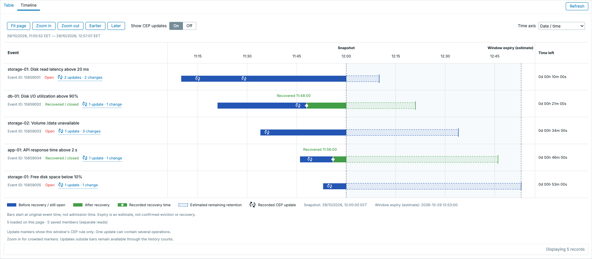
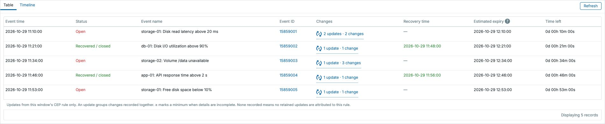
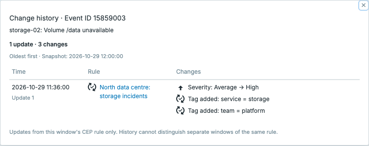

# CEP Window Inspector for Zabbix

A read-only frontend module for exploring saved Complex Event Processing (CEP) windows, their member events and recorded CEP updates.

> [!WARNING]
> **FOR EDUCATIONAL PURPOSES ONLY.** This experimental community module is intended for learning, labs and demonstrations. It is not recommended for production or business-critical monitoring. This is intended-use guidance, not an additional restriction on the GNU AGPL licence.

> [!IMPORTANT]
> **AI-GENERATED IMPLEMENTATION.** The implementation was generated with ChatGPT and OpenAI Codex under the project author's direction. No independent security audit or production certification is claimed. See [NOTICE.md](NOTICE.md) and [DISCLAIMER.md](DISCLAIMER.md).

**Original project author:** [Kaspars Mednis (madKaspars)](https://github.com/madKaspars)  
**Module version:** 1.5.7  
**Tested with:** Zabbix **8.0.0rc3**<br>
**Licence:** [GNU AGPL v3 only](LICENSE) (`AGPL-3.0-only`)

## Features

- Saved windows with descriptive **View window #…** links, rule links, member counts and expiry estimates.
- Native Zabbix **Table** and **Timeline** tabs; Table opens by default.
- Adaptive timeline for durations from **1 minute to 365 days**, with zoom, pan, fit and frontend timezone formatting.
- Blue before recovery, green after recovery, and a white diamond at the recorded recovery time. Snapshot and estimated window expiry have separate boundaries.
- Explicit cause/symptom roles, linked cause IDs and a window-wide relationship summary.
- CEP history with native Zabbix symbols and click-only popups. **1 update · 3 changes** distinguishes a recorded batch from its individual operations.
- Optional CEP symbols inside timeline bars; the native **On / Off** control defaults to **Off**.
- An in-place **Refresh** beside the tabs preserves the active tab, update visibility, time-axis format and zoom/pan range.
- Super-admin-only access, read-only queries and bounded member/history pages. No core frontend edits, database migrations or background jobs.

## Preview

These screenshots use a synthetic storage-monitoring scenario, not real monitoring data. Five events start at different times in a one-hour simple window, producing staggered expiry estimates; two events have recorded recoveries. Bars start at original event time, not recorded admission time. CEP updates are enabled for the timeline illustration; the installed module defaults to Off. The installed Zabbix version and theme determine the surrounding interface.



<details>
<summary>Table and CEP update popup</summary>





</details>

## Compatibility

Tested with **Zabbix 8.0.0rc3**. Automated checks use the official RC3 source and its native module loader, HTML classes and helpers. The maintainer has also tested the module on an RC3 installation. See [validation details](VALIDATION.md).

Use a matching CEP-enabled server, database schema and frontend. The module requires CEP window tables and CEP update fields, native frontend helpers/icons, and SQL window functions. Older installations without these features are not compatible. Other releases require testing; this is not a claim of compatibility with every Zabbix 8 build.

Access requires a **Super admin** because direct database reads do not apply ordinary API host-permission filtering. JavaScript is required for the timeline, in-place refresh and history popup; the server-rendered table remains available without it. See [data semantics and requirements](docs/BEHAVIOR.md) and [validation](VALIDATION.md).

## Install

1. Use an isolated lab with a compatible Zabbix installation and a backup/recovery route.
2. Download the source with **Code → Download ZIP**, or download a published release ZIP. Extract it and place the directory containing `manifest.json` at `modules/cep-window-inspector/` in the actual frontend directory.
3. Open **Administration → General → Modules**, scan the directory and enable **CEP Window Inspector**.
4. As a Super admin, open **Monitoring → CEP windows**.

For a source checkout or GitHub-generated source ZIP, copy the repository contents into a folder named `cep-window-inspector` first. Avoid an extra nested directory around `manifest.json`. See [installation and removal](docs/INSTALL.md). No server restart or schema change is required by this module.

## Reading the data

- This is **current saved membership**, not historical playback. Deleted memberships cannot be reconstructed.
- **History unavailable** means a saved member exists but its event history cannot be read; it is not proof that the event is open or recovered.
- Expiry is an **estimate**, not an actual removal or recovery time. Arrivals, CEP operations and worker scheduling can change it.
- CEP history is filtered to the **selected window's saved rule ID**. Logs have no window instance ID or admission timestamp, so different windows of the same rule can still share an event's history.
- The timeline shows up to 100 members per page and the latest 20 CEP updates per event. Popups page through retained updates, 50 at a time. `≥` indicates a lower-bound change count.
- The lower **Refresh** preserves display settings. Browser reload and the header Refresh perform a full reload and reset CEP update visibility to Off.

Full explanations are in [docs/BEHAVIOR.md](docs/BEHAVIOR.md).

## Development and packaging

See [CONTRIBUTING.md](CONTRIBUTING.md) for local checks. Build a deterministic release archive using Python 3.10 or later:

```sh
python3 scripts/package_release.py
```

This creates `dist/cep-window-inspector-for-zabbix-v1.5.7.zip` and `dist/SHA256SUMS`. It includes the module, complete project source, tests, scripts, documentation and notices, under `cep-window-inspector/`.

[Release guide](docs/PUBLISHING.md) documents packaging and publication steps. The workflows validate changes and attach assets only after a release is explicitly published; they do not create or publish releases themselves.

## Attribution, licence and support

Original project author and maintainer: **Kaspars Mednis (madKaspars)**. Source headers and [NOTICE.md](NOTICE.md) carry this credit separately from the AI-generation disclosure. Fork maintainers can add their own contribution and maintenance credits while retaining applicable original notices.

Distributed under [GNU AGPL v3 only](LICENSE). Please retain original project attribution in forks; applicable licence and notice obligations are governed by the licence. Project credit does not claim copyright over material that is not copyrightable.

It is not affiliated with, endorsed by, or supported by Zabbix LLC or Zabbix SIA. Zabbix is a registered trademark of Zabbix LLC. Provided as is, without warranty to the extent permitted by law. Maintenance is voluntary, with no guaranteed support or response time. See [DISCLAIMER.md](DISCLAIMER.md), [SECURITY.md](SECURITY.md) and [CHANGELOG.md](CHANGELOG.md).
